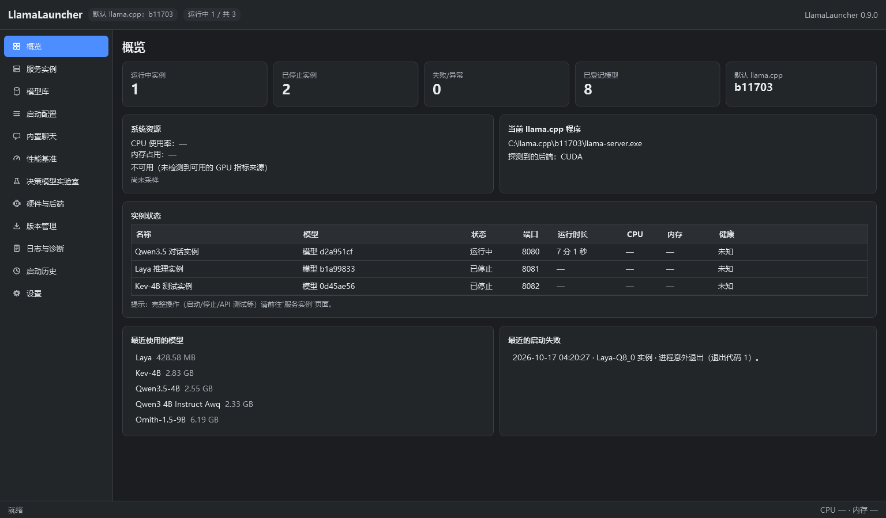
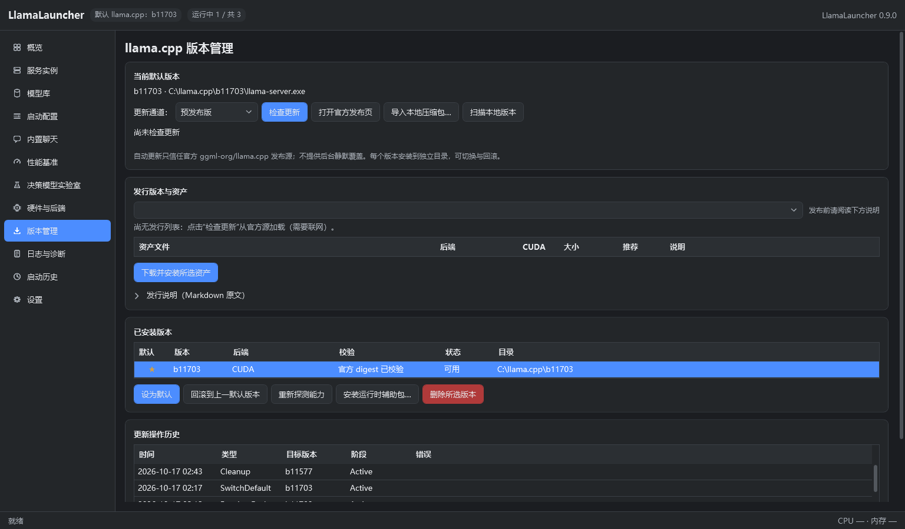
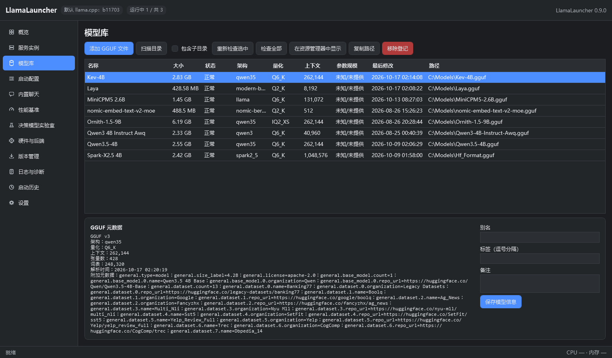
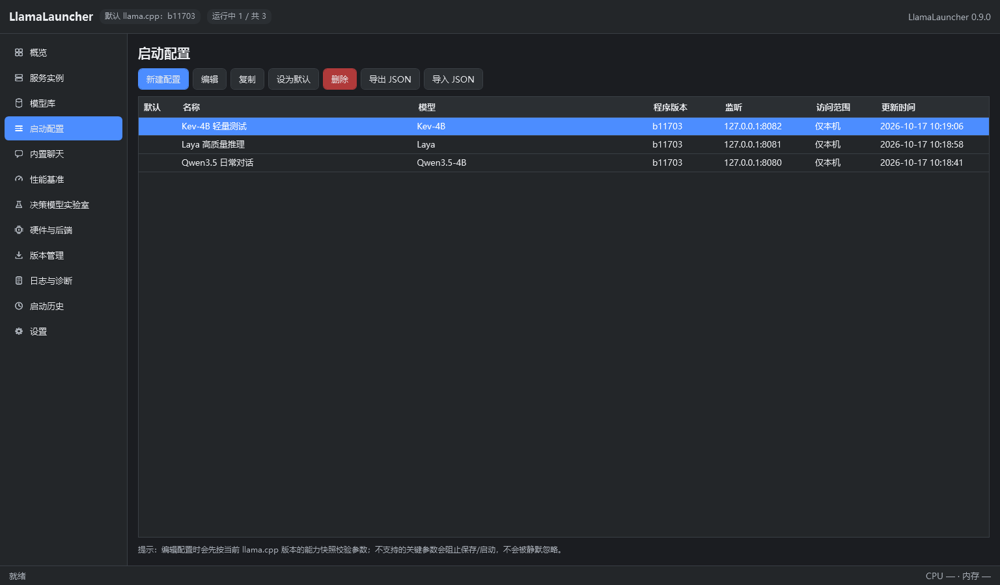
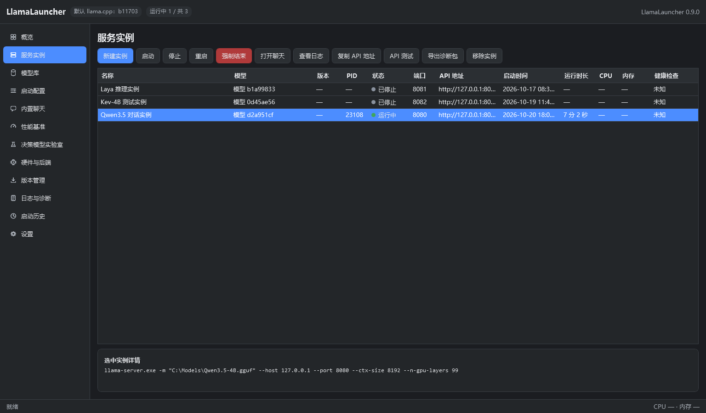
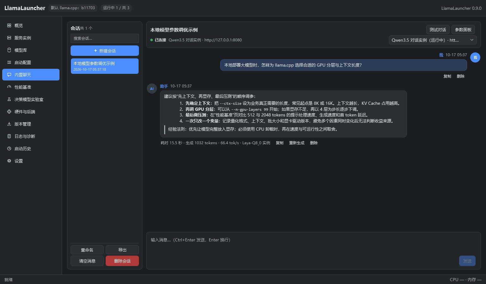
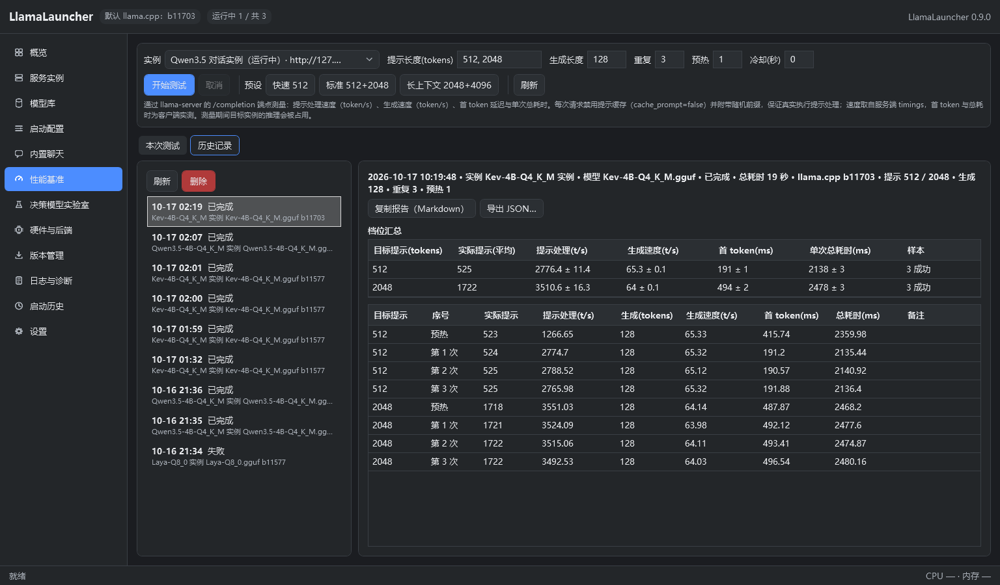
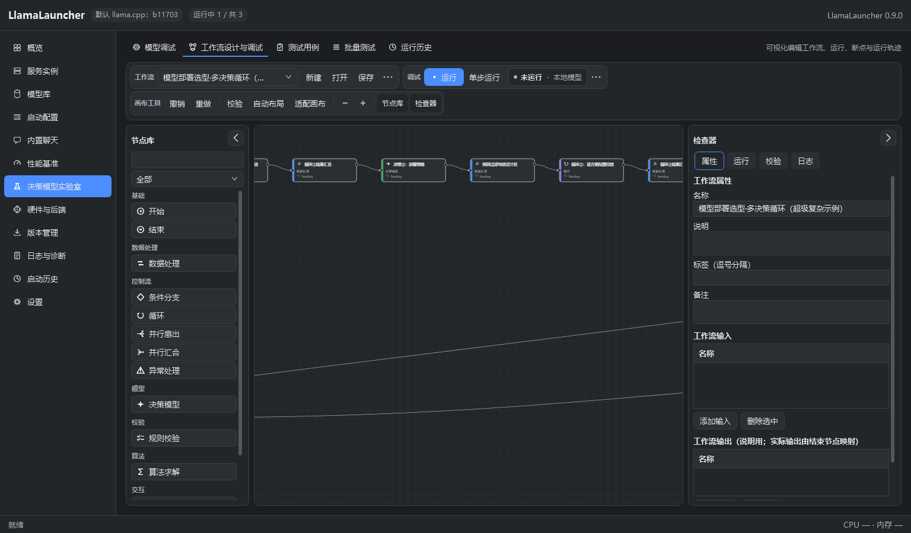
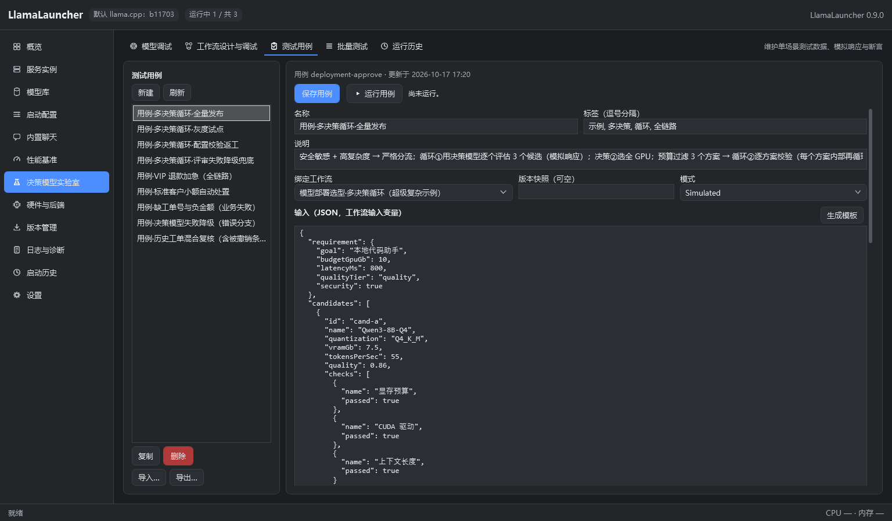

# LlamaLauncher


**面向 Windows 的 llama.cpp 桌面启动器与管理中心。**<br>
用统一界面管理本地 GGUF 模型、llama-server 多实例、启动配置、流式聊天、性能基准、版本升级和决策模型工作流。

[](https://github.com/DZBEX/llamaGui)
[](https://dotnet.microsoft.com/download/dotnet/8.0)
[](https://github.com/DZBEX/llamaGui)
[](https://github.com/ggml-org/llama.cpp)

> LlamaLauncher 不下载 GGUF 模型。模型始终由用户提供，应用只登记文件、读取元数据并生成 `llama-server.exe` 启动参数。



> 截图来自当前仓库代码的演示环境，样例模型、实例、工作流和聊天内容仅用于展示功能。

## 目录

- [为什么使用 LlamaLauncher](#为什么使用-llamalauncher)
- [功能一览](#功能一览)
- [环境要求](#环境要求)
- [快速开始](#快速开始)
- [界面与使用说明](#界面与使用说明)
  - [概览](#1-概览)
  - [版本管理](#2-版本管理)
  - [模型库](#3-模型库)
  - [启动配置](#4-启动配置)
  - [服务实例](#5-服务实例)
  - [内置聊天](#6-内置聊天)
  - [性能基准](#7-性能基准)
  - [决策模型实验室](#8-决策模型实验室)
  - [日志、历史与设置](#9-日志历史与设置)
- [从源码构建](#从源码构建)
- [发布与便携版](#发布与便携版)
- [数据目录与备份](#数据目录与备份)
- [安全说明](#安全说明)
- [常见问题](#常见问题)
- [项目结构](#项目结构)
- [文档与贡献](#文档与贡献)
- [许可与第三方组件](#许可与第三方组件)

## 为什么使用 LlamaLauncher

直接运行 `llama-server.exe` 通常需要手工拼参数、管理端口、检查进程状态并在多个终端窗口之间切换。LlamaLauncher 把这些工作集中到一套 Windows 桌面工作流中：

- 启动前检查模型、程序、端口、参数与二进制能力，减少“命令看起来没问题，进程却立即退出”的情况。
- 每个实例拥有独立端口、日志、健康检查与启动历史，支持同时运行多个模型。
- 将配置保存为结构化档案，参数校验、命令预览、导入导出可重复执行。
- 通过真实 SSE 流式接口聊天，并持久化会话、采样参数与生成指标。
- 对运行中的实例进行可复现的性能基准，记录提示处理、生成速度、首 token 延迟与历史结果。
- 对 llama.cpp 版本执行下载、校验、探测、切换与回滚；不同版本安装在独立目录。
- 提供决策模型调试、可视化工作流、断点运行、游戏测试、测试用例、批量回归和运行历史。

## 功能一览

| 模块 | 核心能力 |
| --- | --- |
| 多实例 | 并行启动多个 `llama-server.exe`；独立端口、日志、健康检查、资源采样与启动历史 |
| 能力探测 | 执行 `--version`、`--help`、`--list-devices` 并缓存能力快照；只生成当前二进制支持的参数 |
| 模型库 | 登记/扫描本地 GGUF、读取文件头元数据、别名/标签/备注、失效检测；移除登记不删除文件 |
| 启动配置 | 结构化参数、预设、能力校验、脱敏命令预览、高级参数冲突检测、JSON 导入导出 |
| 内置聊天 | 真实流式输出、停止生成、Markdown 安全渲染、代码复制、会话持久化、重新生成与导出 |
| 性能基准 | `/completion` 流式测速、多档提示长度、预热/重复/冷却、均值±标准差、历史与报告导出 |
| 决策实验室 | `/v1/systemone` 调试、可视化工作流、断点/单步、游戏测试、测试用例、批量回归、运行比较 |
| 版本管理 | GitHub Releases、稳定/预发布通道、SHA-256、ZIP 安全检查、默认版本切换与回滚 |
| 日志诊断 | 应用日志与实例 stdout/stderr、滚动保留、搜索、脱敏诊断包 |
| 安全默认 | 默认仅监听 `127.0.0.1`；密钥使用 Windows DPAPI；日志、历史和导出自动掩码 |
| 便携数据 | 默认将数据库、日志、版本和备份放在程序目录；整目录移动时自动修复内部绝对路径 |

## 环境要求

### 运行应用

- Windows 10 1809+ 或 Windows 11，x64。
- 如果要使用 GPU 推理，需要与该 llama.cpp 构建匹配的显卡驱动与后端运行库。
- 自包含便携版无需预装 .NET；框架依赖版本需要 .NET Desktop Runtime 8。

### 准备推理环境

至少需要以下两项：

1. 一套完整的 llama.cpp Windows 发行包，其中包含 `llama-server.exe` 及其同目录 DLL。
2. 一个本地 `.gguf` 模型文件。

> 不要把 `llama-server.exe` 单独复制出来。官方新版通常还依赖 `ggml*.dll`、`llama*.dll` 等文件，能力探测或模型加载可能因此失败。

## 快速开始

### 1. 获取并启动 LlamaLauncher

当前推荐从源码构建：

```powershell
git clone https://github.com/DZBEX/llamaGui.git
cd llamaGui
dotnet build LlamaLauncher.sln -c Release
dotnet run --project src/LlamaLauncher.App -c Release
```

也可以运行构建后的程序：

```powershell
src\LlamaLauncher.App\bin\Release\net8.0-windows\LlamaLauncher.exe
```

如果仓库后续提供 Release 安装包或便携包，可直接解压/安装并运行 `LlamaLauncher.exe`。

### 2. 安装或导入 llama.cpp

打开“版本管理”，选择与硬件匹配的官方资产，或导入本地完整压缩包。应用安装后会立即探测版本、参数和设备。



如果本机已经有可用的 `llama-server.exe`，也可以跳过下载，在“启动配置”编辑器中直接选择“选择其他 exe…”。

### 3. 登记 GGUF 模型

打开“模型库”：

- 点击“添加 GGUF 文件”登记单个模型；
- 或点击“扫描目录”批量发现目录中的 GGUF；
- “包含子目录”控制是否递归扫描。

LlamaLauncher 只读取模型文件头以提取架构、量化、上下文等元数据。移除登记不会删除磁盘文件。



### 4. 创建启动配置

打开“启动配置 → 新建配置”：

1. 选择模型和 llama.cpp 程序。
2. 设置主机、端口、上下文长度、GPU 分层、线程和采样参数。
3. 检查冲突与能力提示。
4. 查看脱敏后的命令预览。
5. 保存配置。



### 5. 创建并启动实例

打开“服务实例 → 新建实例”，选择刚才的配置。点击“启动”后，状态会依次经历：

```text
已停止 → 启动中 → 加载模型中 → 运行中
```

状态停在“加载模型中”时，大模型可能仍在读取权重；如果进程退出，则会进入“失败”或“异常退出”，并记录退出码与错误摘要。



### 6. 开始聊天

实例进入“运行中”后，打开“内置聊天”：

- 选择目标实例；
- 输入消息并按 `Ctrl+Enter` 发送；
- 生成中可随时停止；
- 右侧“参数面板”可调整系统提示词与采样参数。



## 界面与使用说明

### 1. 概览

概览集中展示：

- 运行中、已停止、失败实例数量；
- 已登记模型数量与默认 llama.cpp 版本；
- CPU、内存、可验证来源的 GPU 指标；
- 当前活动实例、最近模型与启动失败摘要。

顶部状态栏同时显示默认版本和实例汇总，底部状态栏显示最近操作与资源摘要。

### 2. 版本管理

推荐使用稳定通道；需要尝鲜时可切换到预发布通道。

常用流程：

1. 点击“检查更新”，从官方 `ggml-org/llama.cpp` Releases 加载发行列表。
2. 检查资产名中的后端、CUDA 版本和平台，选择适合本机的安装包。
3. 点击“下载并安装所选资产”。
4. 应用执行 SHA-256 校验、安全解压与能力探测，成功后登记为新版本。
5. 点击“设为默认”切换默认版本；需要时使用“回滚到上一默认版本”。

本地版本发现：

- 启动时自动扫描默认版本目录；
- 可手动点击“扫描本地版本”；
- 推荐目录名为 `<版本标签>-<指纹>`，例如 `b10618-91b16d71`；
- 目录中必须包含完整发行文件。

注意事项：

- 每个版本安装到独立目录，不会覆盖正在使用的版本。
- 运行中的实例不受默认版本切换影响。
- 官方没有提供 digest 时，界面会明确标注“本地指纹（非来源校验）”。
- GitHub API 频率受限或离线时，界面会回退到最近一次成功缓存，并标注缓存时间。

### 3. 模型库

“添加 GGUF 文件”和“扫描目录”都会执行轻量文件头解析。表格中可查看：

- 文件大小、可用状态；
- 架构、量化、上下文长度和参数规模；
- 文件修改时间与实际路径；
- 自定义别名、标签与备注。

建议：

- 用“别名”记录业务用途，例如“代码助手”“中文总结”。
- 用标签记录量化、语言或硬件适配信息。
- 文件移动后点击“重新检查选中”；失效状态不等于自动清除记录。
- 模型目录可以在“设置 → 路径设置”中指定。

### 4. 启动配置

配置是模型、程序与参数的可复用组合。常用参数：

| 参数 | 作用 | 调整建议 |
| --- | --- | --- |
| `--ctx-size` | 上下文窗口 | 从业务真实需求出发，避免无意义地拉满 |
| `--n-gpu-layers` | 卸载到 GPU 的层数 | 显存不足时逐步降低；以实际能力探测和运行结果为准 |
| `--batch-size` / `--ubatch-size` | 批处理大小 | 提高吞吐可能增加显存占用；保持合理关系 |
| `--threads` | CPU 线程数 | 通常从接近物理核心数开始测试，避免远高于硬件并发能力 |
| `--flash-attn` | Flash Attention | 具体取值因 llama.cpp 版本而异，由能力快照决定 |
| `--host` / `--port` | 监听地址与端口 | 默认保持 `127.0.0.1`；端口不能与现有实例重叠 |

高级参数：

- 面板支持额外原生命令行参数；
- 与 UI 管理的参数冲突时默认阻止保存；
- 开启“允许高级参数覆盖”后以额外参数为准，并记录警告；
- 建议先在命令预览中确认最终 argv。

配置交换：

- “导出 JSON”默认不包含秘密引用名，也绝不包含密钥本体；
- 导入前会显示预览与路径检查结果；
- 可以复制配置并保留模型/程序绑定。

### 5. 服务实例

每个实例都是独立运行代次，拥有自己的进程、端口、日志和健康状态。

常用操作：

| 操作 | 说明 |
| --- | --- |
| 启动 | 重新执行模型、程序、参数、端口与安全校验 |
| 停止 | 先请求退出，超时后再按受控流程处理进程树 |
| 重启 | 停止当前代次并按配置重新启动 |
| 强制结束 | 仅用于普通停止无效的场景；可能中断未保存的推理结果 |
| 打开聊天 | 跳转到内置聊天并选择对应实例 |
| 查看日志 | 查看该实例的 stdout/stderr |
| 复制 API 地址 | 复制本机 OpenAI 兼容 API 根地址 |
| API 测试 | 查询模型/健康信息并验证对话端点 |
| 导出诊断包 | 收集脱敏日志与运行摘要 |

实例命令预览、日志与历史会对 API Key 做掩码。PID、启动时间和可执行文件路径用于进程身份校验，避免误杀同名进程。

### 6. 内置聊天

聊天页通过 llama-server 的 OpenAI 兼容端点读取真实 SSE 流。

快捷键与交互：

- `Ctrl+Enter`：发送消息；
- `Enter`：换行；
- 生成中可“停止生成”；
- 消息支持复制、删除与重新生成；
- 代码块右上角可直接复制代码；
- 手动上翻消息区后自动滚动暂停，可点击“回到底部”。

参数面板：

- 系统提示词；
- `temperature`、`top_p`、`top_k`、`min_p`；
- `repeat_penalty`、`seed`、最大生成 token 数与停止序列；
- “重置默认”只恢复采样参数，不覆盖系统提示词。

会话与导出：

- 消息增量持久化到 SQLite；
- 应用异常退出后，未完成消息在下次启动标记为“已中断”；
- 会话可重命名、清空、删除或导出为 Markdown。

### 7. 性能基准

性能基准用于比较模型、量化、参数和硬件的实际推理表现。

测试流程：

1. 选择一个“运行中”的实例。
2. 设置提示长度档位，例如 `512, 2048`。
3. 设置生成长度、重复次数、预热次数与冷却秒数。
4. 选择“快速 512”“标准 512+2048”或“长上下文 2048+4096”预设。
5. 点击“开始测试”，过程中可取消。
6. 在“本次测试”查看汇总和样本，在“历史记录”比较旧结果。



指标说明：

| 指标 | 含义 |
| --- | --- |
| 提示处理速度 | 服务端处理的 prompt token / 秒 |
| 生成速度 | 服务端生成的 completion token / 秒 |
| 首 token 延迟 | 从请求开始到客户端收到首段有效内容 |
| 单次总耗时 | 客户端测得的完整请求耗时 |
| 均值 ± 标准差 | 排除预热和失败样本后的同档统计 |

测量时会禁用提示缓存并附加随机前缀，避免 KV Cache 复用导致 prefill 结果虚高。测试期间目标实例的推理能力会被占用。

结果可复制为 Markdown 报告或导出 JSON；运行记录增量写入 SQLite，中途取消也会保留已完成样本。

### 8. 决策模型实验室

实验室包含六个子页：

1. **模型调试**：输入 state 与 questions，调用 `/v1/systemone`，查看结构化概率、原始响应与耗时。
2. **工作流设计与调试**：拖放节点、连线、属性编辑、校验、运行、断点、单步和轨迹。
3. **测试用例**：维护输入、模拟响应、断言、忽略字段与测试模式。
4. **批量测试**：选择用例、控制并发、暂停/继续/取消，并导出结果。
5. **游戏测试**：用贪吃蛇、五子棋和俄罗斯方块逐步驱动模型，查看每轮状态、模型选择、
   置信度、耗时和动作结果；支持自动测试、暂停、单步与五子棋人机对弈。规则引擎会过滤危险动作、
   裁剪战术候选或预评估完整落点，模型只在缩小后的候选中决策。
6. **运行历史**：查看输入输出、节点/日志/变量，对两次运行做字段级比较。



最小上手路径：

```text
启动一个决策模型实例
  → 模型调试：验证 /v1/systemone
  → 工作流设计：拖入节点并连线
  → 校验并运行：观察轨迹与节点详情
  → 测试用例：配置模拟响应与断言
  → 批量测试与运行历史：回归与比较
```

测试用例编辑器：



工作流与表达式只使用白名单操作，不执行任意 C#、脚本或命令。完整节点、表达式、模板与 JSON 格式见 [决策模型实验室文档](docs/DECISION_LAB.md)。

### 9. 日志、历史与设置

日志与诊断：

- 应用日志与每个实例的 stdout/stderr 分开保存；
- 支持搜索、复制、滚动保留和容量限制；
- 诊断包包含运行信息与脱敏日志，不包含聊天数据库和密钥明文。

启动历史：

- 记录实例名、PID、最终状态、退出码、失败阶段和时间；
- 展示脱敏命令行与错误摘要；
- 用于区分端口占用、能力校验、进程启动和健康检查失败。

设置：

- 深色/浅色主题；
- 关闭到托盘、启动到托盘和开机启动；
- 数据目录与便携模式；
- llama.cpp 版本目录、下载目录与模型目录；
- 资源采样间隔、日志保留与轮转；
- 更新通道、自动检查间隔；
- 可选 GitHub 只读令牌；
- 数据库备份与恢复。

常用快捷键：

| 快捷键 | 功能 |
| --- | --- |
| `Ctrl+Enter` | 在聊天输入框中发送消息 |
| `Enter` | 在聊天输入框中换行 |

## 从源码构建

### 前置条件

- .NET SDK 8.0；
- Windows x64；
- 可选：PowerShell 7、Inno Setup 6（仅构建安装包时需要）。

检查 SDK：

```powershell
dotnet --info
```

### 快速构建

```powershell
dotnet restore LlamaLauncher.sln
dotnet build LlamaLauncher.sln -c Release
```

### 全部测试

```powershell
pwsh -File scripts/build.ps1
```

脚本执行 Release 构建，并依次运行单元测试、集成测试和 UI 测试。

也可以单独运行：

```powershell
dotnet test tests/LlamaLauncher.UnitTests -c Release
dotnet test tests/LlamaLauncher.IntegrationTests -c Release
dotnet test tests/LlamaLauncher.UiTests -c Release
```

### 无界面冒烟测试

```powershell
src\LlamaLauncher.App\bin\Release\net8.0-windows\LlamaLauncher.exe --smoke-test
```

成功时输出 `SMOKE_OK` 并退出。该模式会验证依赖容器、数据库初始化、实验室视图实例化与关键布局。

## 发布与便携版

### 自包含便携版

```powershell
pwsh -File scripts/publish-portable.ps1
```

生成：

- `artifacts/portable/LlamaLauncher-<版本>-win-x64/`
- `artifacts/portable/LlamaLauncher-<版本>-win-x64.zip`
- 对应的 `.sha256` 校验文件

自包含版本无需预装 .NET。

### 同时附带 llama.cpp

```powershell
pwsh -File scripts/publish-portable.ps1 `
  -IncludeRuntimes `
  -RuntimesSource "D:\path\to\runtimes\llama.cpp"
```

目标电脑仍需具备匹配的显卡驱动与系统环境。GGUF 模型不会自动打入发布包。

### 框架依赖版本

```powershell
pwsh -File scripts/publish-portable.ps1 -FrameworkDependent
```

需要目标电脑安装 .NET Desktop Runtime 8。

### Windows 安装包

```powershell
pwsh -File scripts/build-installer.ps1
```

需要 Inno Setup 6。脚本会自动检测环境；未安装时会输出获取与配置提示。

## 数据目录与备份

便携模式默认把应用数据放在程序目录：

```text
LlamaLauncher/
├─ data/llamalauncher.db
├─ logs/
├─ downloads/
├─ runtimes/llama.cpp/<版本-指纹>/
├─ manifests/installations.json
├─ backups/
├─ exports/
├─ workflows/
│  ├─ *.workflow.json
│  ├─ snapshots/
│  └─ testcases/
└─ cache/
```

如果程序目录不可写，应用会回退到：

```text
%AppData%\LlamaLauncher
```

整包迁移到另一台电脑：

1. 退出 LlamaLauncher；
2. 复制整个程序目录，包含 `data/` 与 `runtimes/`；
3. 在新位置启动；
4. 应用会识别旧根路径并改写数据库、配置和安装清单中的内部绝对路径；
5. GGUF 模型不会自动移动，仍需放到相同路径或重新选择。

在线备份与恢复：

- “设置”页可创建当前 SQLite 数据库备份；
- 恢复前会自动备份当前数据库；
- 恢复失败会尝试回滚；
- 恢复完成后需要重启应用。

## 安全说明

- 默认监听 `127.0.0.1`，不提供公网直接暴露的一键开关。
- 局域网监听需要风险确认、已配置 API Key，且当前二进制支持 `--api-key`。
- API Key 使用 Windows DPAPI（CurrentUser）加密存储；日志、命令预览、启动历史和诊断包会掩码。
- API Key 不提供传输加密。跨不可信网络请自行使用带 TLS 的反向代理。
- Markdown 通过 WPF FlowDocument 渲染，不执行 HTML 或 JavaScript。
- 外链只允许 `http`、`https`、`mailto`，并在系统浏览器中打开。
- 自动更新只使用 HTTPS 官方源，并校验 digest、ZIP 路径和探测结果。
- 应用只终止身份可验证、由自身启动的服务进程。
- 删除版本目录前会做路径边界与配置引用检查；模型文件永不自动删除。

详细信任边界与实现见 [安全模型](docs/SECURITY.md)。

## 常见问题

### 端口已被占用

换一个端口，或停止占用端口的其他实例/程序。应用不会抢占已被占用的端口。

### 当前版本不支持某个参数

查看“硬件与后端”中的能力快照和原始帮助输出。移除不受支持的参数，或切换到支持该参数的 llama.cpp 版本。应用不会静默忽略未知的关键参数。

### 能力探测失败

常见原因：

- 只复制了单个 exe，缺少同目录 DLL；
- CPU/GPU 架构或官方包平台不匹配；
- CUDA/Vulkan 运行时或显卡驱动不兼容；
- 文件被安全软件隔离或路径不可读。

先查看原始探测输出，再重新导入完整发行包。

### 界面显示“未探测到 GPU 推理设备”

这表示当前二进制的 `--list-devices` 没有报告可用 GPU。机器存在 NVIDIA 显卡并不自动代表当前构建是 CUDA 构建。请检查资产类型、对应 DLL 和驱动，以实际输出为准。

### 显存不足

尝试：

- 降低 `--n-gpu-layers`；
- 降低上下文长度；
- 降低 batch/ubatch；
- 减少并行槽位；
- 使用更小的量化或更小的模型。

先修改一个参数并记录结果，避免同时改变多个变量后无法定位瓶颈。

### 流式聊天中断

检查实例是否仍在运行、日志中是否有服务端错误，以及代理/网络是否中断。已经收到的内容会保留并标记为“已中断”，可以重新生成。

### GitHub 更新检查失败

- 无网络或代理环境可手动下载官方包后“导入本地压缩包”；
- 未登录 GitHub API 配额为每小时 60 次，按出口 IP 计算；
- 应用会缓存最近成功列表，并在频率限制期间显示缓存；
- 可在设置中配置只读 GitHub 令牌，把配额提高到 5000 次/小时。

更多排障步骤见 [故障排查](docs/TROUBLESHOOTING.md)。

## 项目结构

```text
LlamaLauncher.sln
├─ src/
│  ├─ LlamaLauncher.Domain          # 实体、状态机、校验、工作流/基准领域模型
│  ├─ LlamaLauncher.Contracts       # llama-server HTTP API DTO
│  ├─ LlamaLauncher.Application     # 用例编排、命令构建、SSE、工作流引擎
│  ├─ LlamaLauncher.Infrastructure  # SQLite、进程、HTTP、DPAPI、WMI、更新与文件系统
│  └─ LlamaLauncher.App             # WPF Shell、View、ViewModel、主题与 UI 服务
├─ tests/
│  ├─ LlamaLauncher.UnitTests
│  ├─ LlamaLauncher.IntegrationTests
│  ├─ LlamaLauncher.UiTests
│  └─ LlamaLauncher.TestChildProcess
├─ docs/
├─ scripts/
└─ installer/
```

分层依赖保持单向：

```text
App ───────────────► Application ──────► Domain
 │                        │                ▲
 │                        ▼                │
 └──► Infrastructure ─────┴──────► Contracts┘
```

更完整的运行时流程、数据表和设计决策见 [架构说明](docs/ARCHITECTURE.md)。

## 文档与贡献

详细文档：

- [用户手册](docs/USER_GUIDE.md)
- [架构说明](docs/ARCHITECTURE.md)
- [故障排查](docs/TROUBLESHOOTING.md)
- [llama.cpp 兼容策略](docs/LLAMA_CPP_COMPATIBILITY.md)
- [更新系统设计](docs/UPDATE_DESIGN.md)
- [安全模型](docs/SECURITY.md)
- [测试计划与执行结果](docs/TEST_PLAN.md)
- [决策模型实验室](docs/DECISION_LAB.md)
- [实施计划](docs/IMPLEMENTATION_PLAN.md)

提交问题或功能建议：

- [GitHub Issues](https://github.com/DZBEX/llamaGui/issues)

反馈问题时建议附上：

1. 复现步骤与期望结果；
2. Windows 版本、显卡/驱动和 llama.cpp 资产名；
3. 实例状态、退出码与错误摘要；
4. 脱敏诊断包。

提交代码前请运行：

```powershell
pwsh -File scripts/build.ps1
```

## 许可与第三方组件

第三方 NuGet 包及其许可证记录在 [LICENSES.md](LICENSES.md)。

本项目不包含 llama.cpp 二进制或 GGUF 模型；相关运行时由用户自行下载或导入，并遵循其自身许可证。项目自身的再分发授权目前请联系仓库维护者确认。
